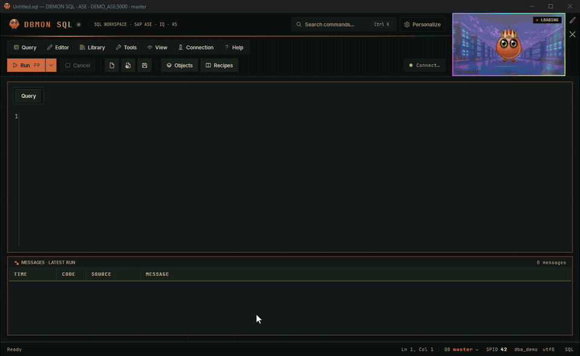
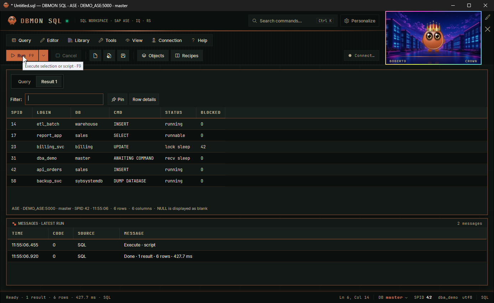
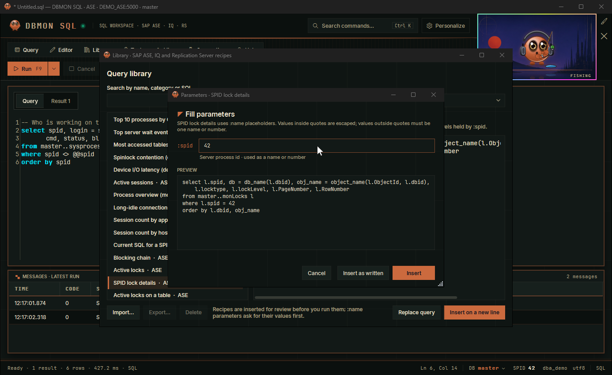
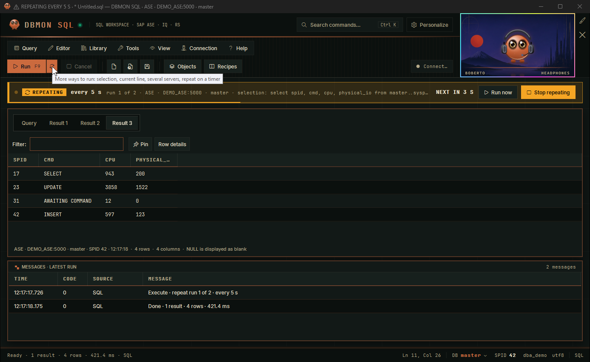
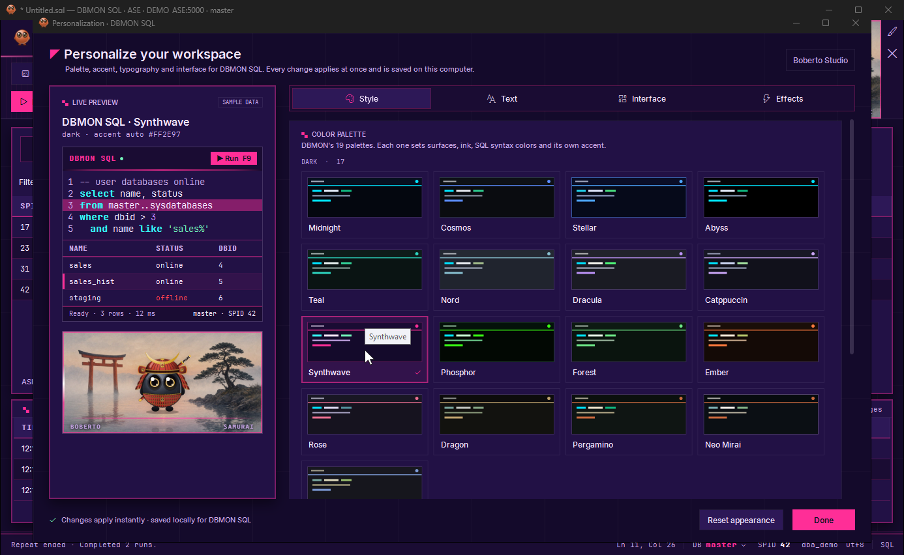
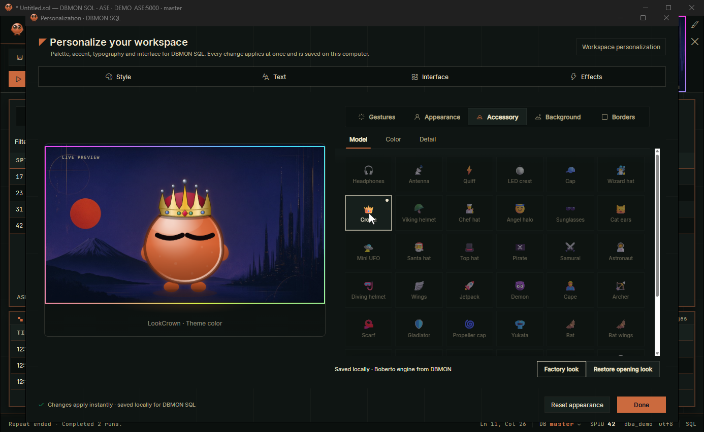
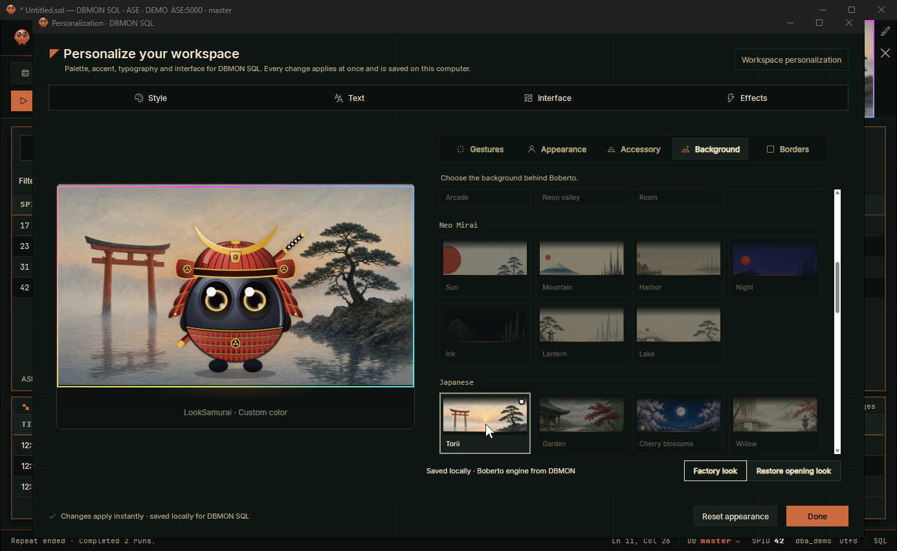

<div align="center">


# DBMON SQL

**A fast, keyboard-first SQL workbench for SAP ASE, SAP IQ and SAP Replication Server on Windows.**

[](https://github.com/ChristianBuzzetti/DBMON_SQL/actions/workflows/ci.yml)
[](LICENSE)




<sub>Recorded from the app's built-in showcase with synthetic data from a fictional <code>DEMO_ASE</code> server · <a href="docs/media/dbmon-sql-tour.mp4">MP4 version</a></sub>

</div>

---

DBMON SQL keeps the dense, keyboard-driven workflow of the classic `isql` / AseIsql tools that Sybase DBAs know, and adds what a modern workbench should have: typed result grids that never lose a `NULL`, server messages kept apart from results, a recipe library with parameters, multi-server runs with diffs, timed repeats and a calm, themeable interface.

## Highlights

| | |
|---|---|
| **Three SAP platforms** | SAP ASE and Replication Server through the SAP ASE ODBC driver, SAP IQ through the SAP IQ ODBC driver. Pick the server type at login; aliases come straight from your `sql.ini`. |
| **Real SQL editor** | AvalonEdit with syntax colors, line numbers, find and replace, bookmarks, comment toggling, case transforms, duplicate line and zoom. `F9` runs the script or selection, `Ctrl+E` the selection, `Alt+F9` the current line. |
| **Results you can trust** | Typed values and `NULL` are preserved; results accumulate in tabs; `F9` on a result tab re-runs exactly that query in place. Pin, rename, filter, transpose, chart, inspect rows, sum numeric selections, copy in several formats and export to CSV, JSON, Markdown, HTML, `IN` lists or `INSERT` statements. |
| **Messages stay messages** | Server prints, warnings and errors go to their own panel with code and source, never into a fake result grid. The original driver diagnostic is one click away. |
| **Recipe library** | 94 generic recipes tagged **ASE**, **IQ** or **RS** (sessions, blocking, locks, space, log, statistics, `sp_iq*`, `admin who`, queues, DSI…). The library filters by the connected platform. Recipes go on a new line and never overwrite your SQL. |
| **Parameters** | `:name` placeholders ask for their values in a form with a live preview. Quoted values are escaped; unquoted ones must be a single name or number, so a value can never add statements. |
| **Run on several servers** | Execute the same SQL on many sessions in parallel, with per-server results, a combined view and a diff of what differs between servers. Save server groups for later. |
| **Repeat on a timer** | Re-run a query every few seconds, minutes or hours. A caution band stays on screen with the run count and countdown; state-changing SQL needs an explicit acknowledgement. |
| **Object explorer** | Browse ASE databases and IQ tables, views and procedures with server-side filters and paging. Right-click any identifier in the editor for `sp_help`, `sp_iqcolumn`, code, dependencies and more. |
| **Session at a glance** | The status bar shows the current database (click to switch), SPID (click to copy), login and the charset the server negotiated. |
| **Personal** | 19 DBMON palettes, any custom accent color, bundled Inter and JetBrains Mono fonts, density and corner options, and **Boberto**, an animated companion with a studio of costumes, accessories and backgrounds. |

## Screenshots

| Results and session facts | Recipes with parameters |
|---|---|
|  |  |
| **Repeat on a timer** | **19 palettes, applied live** |
|  |  |
| **Boberto Studio** | **Accessories, colors, backgrounds and frames** |
|  |  |

## Requirements

- Windows 10 or 11, **x64**.
- **SAP ASE ODBC driver, 64-bit** (`Adaptive Server Enterprise`, from SAP DataAccess / SDK for SAP ASE) for SAP ASE and Replication Server.
- **SAP IQ ODBC driver, 64-bit** (`SAP IQ`, from the SAP IQ client) for SAP IQ. Optional if you only use ASE.
- A `sql.ini` with your server aliases (usually `%SYBASE%\ini\sql.ini`), or enter host and port manually.
- **Microsoft Edge WebView2 Runtime** for Boberto (included in Windows 11). The SQL workbench works without it.

The drivers and network access are your own: DBMON SQL never installs or changes drivers, `sql.ini` or other tools.

## Getting started

### Run a build

1. Build and test it (see [Building](docs/building.md)):
   ```powershell
   ./build.ps1 -Test -Publish
   ```
2. Start `artifacts/windows-x64-dev/DBMON SQL.exe`. The package is self-contained: no separate .NET install is needed to run it.

### Connect

1. The login opens on start. Choose **Server type** (SAP ASE, SAP IQ or Replication Server).
2. Pick an alias from `sql.ini`, or open **Advanced options** to type host and port.
3. Enter login and password, then **Test connection** or **Connect**.
4. Save the form as a **profile**. Passwords are stored only if you tick **Remember password**, encrypted for your Windows user.

Cancelling the login keeps the app open offline: you can write, open and save SQL, and nothing runs until you connect.

## Keyboard

| Keys | Action |
|---|---|
| `F9` | Run the script or selection · on a result tab, re-run that result in place |
| `Ctrl+E` | Run the selection only |
| `Alt+F9` | Run the current line |
| `Shift+F9` | Run on several servers |
| `Ctrl+Shift+F9` | Repeat on a timer / stop repeating |
| `Esc` | Cancel the running query and stop a repeat |
| `Ctrl+Shift+P` | Fill `:name` parameters in the editor |
| `Ctrl+K` | Search every command |
| `F4` | Object explorer |
| `F11` / `F12` | Connect / disconnect |
| `Ctrl+N` `Ctrl+O` `Ctrl+S` `Ctrl+Shift+S` | New, open, save, save as |
| `Ctrl+R` | Saved query history |
| `Ctrl+F` / `Ctrl+H` | Find / find and replace |
| `Ctrl+F2` / `F2` / `Shift+F2` | Toggle / next / previous bookmark |
| `Ctrl+Shift+D` | Duplicate line |
| `Alt+Z` | Word wrap |
| `Ctrl++` `Ctrl+-` `Ctrl+0` | Editor zoom |
| `Ctrl+Q` | Back to the editor |

More in the [user guide](docs/user-guide.md).

## Privacy and security

- **No telemetry.** The app talks only to the servers you connect to.
- Passwords are never logged or written to disk unless you choose **Remember password**; then they are encrypted with Windows DPAPI for your user.
- Diagnostics shown to you have your password redacted.
- Every connection identifies itself to the server as `DBMON SQL`.
- Boberto runs from packaged local files in an isolated WebView2 profile; no SQL, credentials or remote resources cross into it.
- Local data lives in `%LOCALAPPDATA%\DBMON_SQL` (appearance, profiles, My recipes, server groups, Boberto).

See [SECURITY.md](SECURITY.md) to report a vulnerability.

## Documentation

- [User guide](docs/user-guide.md): connections, editor, results, recipes, parameters, multi-server runs, repeat, explorer, personalization.
- [Building and testing](docs/building.md): toolchain, build script, smoke checks and the showcase recording.
- [Architecture](docs/architecture.md): projects, execution flow and design rules.
- [Changelog](CHANGELOG.md) · [Contributing](CONTRIBUTING.md) · [Third-party notices](THIRD-PARTY-NOTICES.md)

## Status

DBMON SQL is in active development (`0.1.0`). It is used against real SAP ASE and Replication Server environments; SAP IQ support and the IQ object explorer are newer and less exercised. Test in non-production first, and please [open an issue](https://github.com/ChristianBuzzetti/DBMON_SQL/issues) with anything that behaves unexpectedly.

## License

[MIT](LICENSE) © 2026 Christian Buzzetti. Bundled third-party components keep their own licenses; see [THIRD-PARTY-NOTICES.md](THIRD-PARTY-NOTICES.md).

SAP, SAP ASE, SAP IQ, SAP Replication Server and Sybase are trademarks of SAP SE. This project is independent and not affiliated with or endorsed by SAP.
