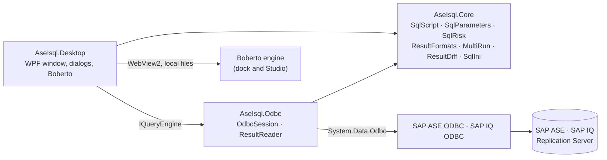

# Architecture

DBMON SQL is a .NET 10 WPF application split so that SQL semantics, the execution engine, storage and the UI stay separate. Project and namespace names keep the original `AseIsql.*` prefix; the product and executable are **DBMON SQL**.

```
src/
  AseIsql.Core      net10.0          SQL semantics and formats; no UI, no ODBC
  AseIsql.Odbc      net10.0-windows  ODBC sessions and result reading
  AseIsql.Desktop   net10.0-windows  WPF application (DBMON SQL.exe)
tests/
  AseIsql.Checks    console          core checks, no server
```



## AseIsql.Core

Platform-neutral building blocks, fully covered by the core checks.

| Type | Role |
|---|---|
| `SqlScript` | Splits scripts on `GO` lines like `isql`, aware of strings, `[brackets]` and nested comments. |
| `SqlParameters` | Finds `:name` placeholders and fills them: escaped inside quotes, one token outside. |
| `SqlRisk` | Flags state-changing statements before a timed repeat. |
| `ConnectionProfile`, `ServerPlatform` | Validated connection settings per platform (ASE, IQ, RS). |
| `SqlIniParser` | Reads `sql.ini` query and master entries without modifying the file. |
| `QueryOutput`, `QueryMessage`, `SessionFacts` | Typed results, server messages and session identity. |
| `ResultFormats`, `FileFormats`, `ResultView` | CSV, JSON, Markdown, HTML, `IN` lists, `INSERT` statements, transposition, filtering. |
| `MultiRun`, `ResultDiff`, `ServerGroups` | Parallel execution on several sessions, combined results and key-based diffs. |

## AseIsql.Odbc

- **`OdbcSession`** owns one ODBC connection. It builds the connection string per platform (SAP ASE driver for ASE and Replication Server, SAP IQ driver with `Host=host:port` for IQ), reads session facts after login (SPID, database, login, charset; nothing on RS), splits batches, honors cancellation and redacts the password from every diagnostic. The application name sent to the server is always `DBMON SQL`.
- **`ResultReader`** streams result sets into typed `DataTable`s within budgets (rows, total bytes, bytes per cell) and stops with a partial-output error instead of truncating values.
- **`DiagnosticMessages`** turns ODBC error records into readable messages while keeping the original text for *View original diagnostic*.

## AseIsql.Desktop

`MainWindow` is a partial class split by concern:

| File | Concern |
|---|---|
| `MainWindow.xaml(.cs)` | Shell, editor, execution (`ExecuteAsync`), keyboard, smoke checks. |
| `MainWindow.Connection.cs` | Login, session chip, status bar facts, database switch, closing. |
| `MainWindow.ResultRuns.cs`, `Results.cs`, `ResultTools.cs` | Accumulated results, re-run in place, copies, exports, pins, charts. |
| `MainWindow.MultiRun.cs` | Run on several servers, groups, combined results and diffs. |
| `MainWindow.Repeat.cs` | Timed repeats, the caution band and the repeat dialog. |
| `MainWindow.Parameters.cs` | The `:name` parameter form. |
| `MainWindow.Browser.cs`, `EditorMenu.cs` | Object explorer (ASE and IQ catalogs) and editor object actions. |
| `MainWindow.Tools.cs` | Recipe library, history, command search, dialogs. |
| `MainWindow.Appearance.cs`, `PersonalizationWindow.cs`, `Themes.cs` | Palettes, accent, typography and the Personalize window. |
| `BobertoDockControl.cs`, `BobertoStudioControl.cs`, `BobertoRuntime.cs` | The companion in WebView2: dock, Studio and a hardened local-only runtime. |
| `ConnectionWindow.xaml(.cs)`, `ProfileStore.cs`, `SqlIniFiles.cs` | Login form, DPAPI-protected profiles, `sql.ini` discovery. |
| `DataFolder.cs` | `%LOCALAPPDATA%\DBMON_SQL` and the one-time move from the old folder. |
| `MainWindow.Showcase.cs`, `ShowcaseRecorder.cs` | Synthetic README tour and its own-window recorder. |

Assets: `dbmon-palettes.json` (19 palettes), `ase-recipes.json` (94 recipes tagged ASE/IQ/RS), bundled fonts with their licenses, and `Assets/Boberto` (engine, Studio, adapters and backgrounds).

## Execution flow

1. **Run** decides what to execute: the editor (selection, script or line), or, on a result tab, that result's recorded SQL.
2. `:name` parameters are filled through the form (unless the SQL came from a result or a repeat, which already holds filled text).
3. `ExecuteAsync` clears Messages, runs `IQueryEngine.Execute` on a worker thread with a cancellation token, and shows elapsed time.
4. `QueryOutput` comes back with typed tables, messages and an error, if any. Tables are published as a **run**: appended after existing tabs, or replacing the run being re-run.
5. Messages and the status bar report counts and time; history records the SQL.

Every engine implements `IQueryEngine` (`Name`, `Execute`); sessions also implement `ISessionFacts`. The smoke checks and the showcase use synthetic engines behind the same interfaces, so the UI paths they exercise are the real ones.

## Design rules

- Values keep their types and `NULL`; server messages are never turned into result grids.
- Nothing runs until there is a connected session; synthetic data exists only behind `--smoke`.
- Passwords are never logged or persisted unless the user asks, and then only with DPAPI.
- Results, recipes and repeats never overwrite user SQL silently: inserts go on new lines, replacements are one undo step.
- Product UI text is English; SQL, object names and server diagnostics are shown as they are.
- Every visual token comes from the palette catalog, so all 19 palettes and any accent stay consistent.
